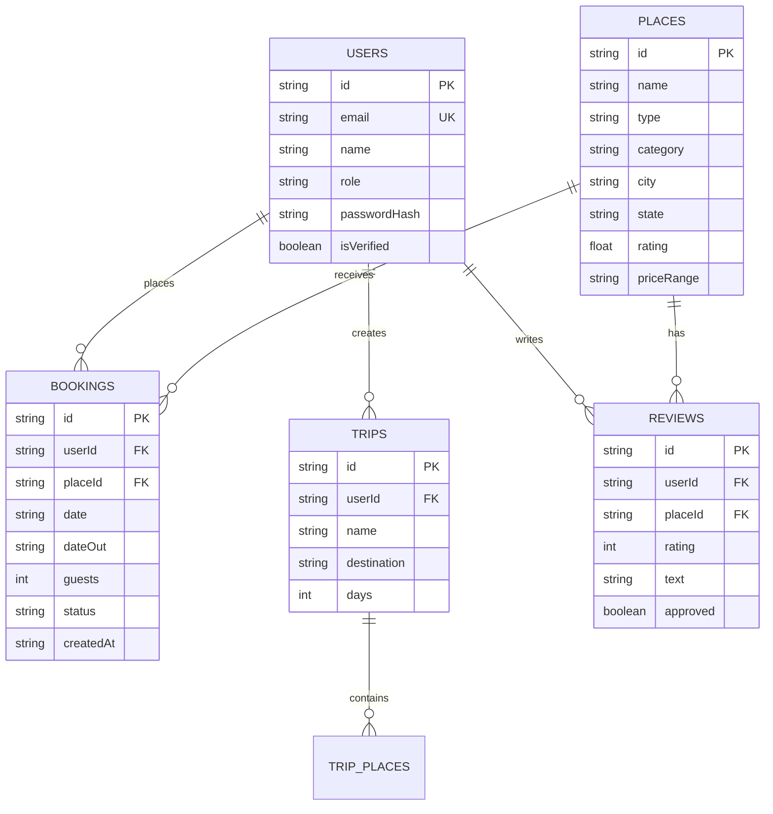

# ExploreIndia — Database Documentation (`DATABASE.md`)

## 1. Executive Summary & Storage Classification

* **Database Type:** **File-Backed JSON Document Store** (Embedded NoSQL simulation).
* **Primary Database File:** [`backend/data_store.json`](file:///c:/Users/satha/Downloads/exploreindia/backend/data_store.json)
* **Configuration Module:** [`backend/src/config/db.ts`](file:///c:/Users/satha/Downloads/exploreindia/backend/src/config/db.ts)
* **Query & Indexing Engine:** [`backend/src/services/databaseEngine.ts`](file:///c:/Users/satha/Downloads/exploreindia/backend/src/services/databaseEngine.ts)
* **Persistence Mechanism:** Synchronous disk flush (`fs.writeFileSync`) on every write operation.

---

## 2. Plain English Explanation of How the Database Works

In software engineering interviews, you must be 100% honest and accurate about your project's storage architecture:

> **Interview Answer:**  
> *"ExploreIndia uses a file-based JSON document database rather than a standalone database server like MySQL or MongoDB. The application loads the entire database into memory on startup as a typed JavaScript object using `fs.readFileSync` and `JSON.parse`. When state modifications occur—such as creating a user, creating a hotel booking, or adding a review—the backend serializes the in-memory object and persists it back to disk via `fs.writeFileSync`. To achieve sub-millisecond query performance across 490+ tourist destinations and 1,280+ cities, an in-memory indexing engine (`DatabaseEngine`) builds inverted index HashMaps on top of the dataset on boot."*

### Why This Is NOT a Traditional Database Server
1. **No External Daemon:** There is no standalone background process (such as `mysqld`, `postgres`, or `mongod`) running on port 3306, 5432, or 27017.
2. **No Network Protocol:** The application communicates with storage directly through operating system file I/O rather than TCP network sockets.
3. **No SQL Engine:** Queries are executed using TypeScript array filter/find operations and in-memory `Map` lookups rather than relational SQL parsers.

### Advantages for a College / Fresher Project
* **Zero Configuration:** Evaluators and recruiters can clone the repository and run it instantly on Windows, macOS, or Linux without installing database servers or configuring containerized databases.
* **Inspectable & Transparent:** The entire dataset is human-readable in VS Code at `backend/data_store.json`.
* **Zero Latency:** Queries execute in in-memory RAM with $O(1)$ indexed access.

---

## 3. Data Schema & Collection Structures

The root database object implements the `Database` interface with the following 9 collections:

```typescript
export interface Database {
  users: User[];                 // User accounts and credential hashes
  places: Place[];               // Hotels, resorts, temples, attractions, restaurants
  bookings: Booking[];           // Hotel and tourist spot reservations
  trips: Trip[];                 // Multi-day custom travel itineraries
  reviews: Review[];             // Place reviews with ratings and admin approval status
  cities: CityInfo[];            // Curated Indian cities with lat/lng and descriptions
  travelTips: TravelTip[];       // Curated travel guides and tips
  searchHistory: SearchHistory[];// Recent user search queries
  notifications: Notification[]; // User account notifications
}
```

---

### Collection Details

#### 1. `bookings` (Hotel & Attraction Reservations)
Stores reservations created by authenticated users.

| Field | Type | Description |
| :--- | :--- | :--- |
| `id` | `string` | Unique booking identifier (e.g., `b-mv3d46qh-qkmmvh`). |
| `userId` | `string` | Foreign key referencing `users.id`. |
| `placeId` | `string` | Foreign key referencing `places.id`. |
| `placeName` | `string` | Name of the booked hotel, resort, or attraction. |
| `placePhoto` | `string` | Thumbnail image URL of the destination. |
| `placeType` | `string` | Category type (`hotel`, `resort`, `attraction`, `restaurant`). |
| `city` | `string` | City where the destination is located. |
| `date` / `checkIn` | `string` | Check-in or visit date (`YYYY-MM-DD`). |
| `dateOut` / `checkOut` | `string` | Check-out date (`YYYY-MM-DD`). |
| `guests` | `number` | Number of reserved guests / tickets (1 to 20). |
| `time` | `string` | Optional time reservation (e.g., `7:30 PM` for dining). |
| `roomType` | `string` | Room category (e.g., `Deluxe Sea View Room`, `Standard Room`). |
| `totalPrice` | `string` | Estimated total price (e.g., `₹4,500`). |
| `status` | `string` | Booking status: `"confirmed"` or `"cancelled"`. |
| `createdAt` | `string` | ISO 8601 creation timestamp. |

#### 2. `places` (Destinations, Hotels & Restaurants)
Stores 490+ curated tourist spots across India.

| Field | Type | Description |
| :--- | :--- | :--- |
| `id` | `string` | Unique place ID (e.g., `p-goa-1`, `dest-hyd-01`). |
| `name` | `string` | Destination name (e.g., `Taj Exotica Resort & Spa`). |
| `type` | `PlaceType` | Primary classification (`hotel`, `resort`, `restaurant`, `cafe`, `attraction`, `temple`). |
| `category` | `string` | Filter category (`hotel`, `temple`, `heritage`, `beach`, `waterfall`, `nature`, `wildlife`, `market`). |
| `rating` | `number` | Aggregated user rating out of 5.0. |
| `reviewCount` | `number` | Number of verified customer reviews. |
| `priceLevel` | `number` | Price indicator from 1 ($) to 4 ($$$$). |
| `priceRange` | `string` | Human-readable price (e.g., `₹25,000 - ₹45,000 per night`). |
| `city` / `state` | `string` | Geographic location details. |
| `coordinates` | `{lat, lng}` | Latitude and longitude for Leaflet OpenStreetMap rendering. |
| `photos` | `string[]` | Curated Unsplash CDN image URLs. |
| `facilities` | `string[]` | Available amenities (WiFi, Pool, AC, Breakfast, Spa, etc.). |
| `rooms` | `Array` | Hotel-specific room types with prices and amenities. |

#### 3. `users` (Authentication & Accounts)
Stores user credentials and profile state.

| Field | Type | Description |
| :--- | :--- | :--- |
| `id` | `string` | User ID (e.g., `admin-id`, `user-id`, `u-abc123xyz`). |
| `name` | `string` | Full name of the user. |
| `email` | `string` | Unique email address (case-insensitive). |
| `role` | `string` | Access tier: `"admin"` or `"user"`. |
| `isVerified` | `boolean` | Email verification flag (completed via 6-digit OTP). |
| `passwordHash` | `string` | Salted bcrypt password hash. |
| `otpCode` | `string` | Most recently generated OTP code for registration or password reset. |
| `favorites` | `string[]` | Array of favorited `placeId` references. |

---

## 4. Entity Relationship Diagram (ERD)



---

## 5. In-Memory Indexing Engine (`DatabaseEngine`)

To ensure real-time response times when searching through hundreds of places, [`backend/src/services/databaseEngine.ts`](file:///c:/Users/satha/Downloads/exploreindia/backend/src/services/databaseEngine.ts) creates in-memory hash indexes upon server startup:

1. **`idIndex` (`Map<string, Place>`)**: $O(1)$ place lookup by ID.
2. **`cityIndex` (`Map<string, Set<string>>`)**: Maps lowercase city names to sets of place IDs.
3. **`categoryIndex` (`Map<string, Set<string>>`)**: Maps normalized categories (`heritage`, `beach`, `hotel`, `temple`) to place IDs.
4. **`tokenIndex` (`Map<string, Set<string>>`)**: Full-text keyword search index mapping name/tag words to place IDs.

---

## 6. How Booking Persistence Works Across Server Restarts

```
┌─────────────────────────────────┐
│ User Submits Booking Form       │
│ POST /api/bookings              │
└────────────────┬────────────────┘
                 │
                 ▼
┌─────────────────────────────────┐
│ Input & Conflict Validation     │
│ - Validate Check-In & Check-Out │
│ - Validate Guests (1 - 20)      │
│ - Prevent Duplicate Conflicting │
└────────────────┬────────────────┘
                 │
                 ▼
┌─────────────────────────────────┐
│ Memory Mutation                 │
│ db.bookings.push(newBooking)    │
└────────────────┬────────────────┘
                 │
                 ▼
┌─────────────────────────────────┐
│ Disk Synchronization            │
│ fs.writeFileSync(               │
│   'backend/data_store.json',    │
│   JSON.stringify(db, null, 2)   │
│ )                               │
└────────────────┬────────────────┘
                 │
                 ▼
┌─────────────────────────────────┐
│ Server Restart Simulation       │
│ Node.js boots up -> db.ts reads │
│ backend/data_store.json         │
│ -> db.bookings has the record!  │
└─────────────────────────────────┘
```

---

## 7. How to Verify That a Booking Was Saved

### Method 1: Automated Integration Test
Run the automated test suite which creates a booking, asserts its ID, and checks persistence:
```bash
npm test
```

### Method 2: Inspect the Physical Database File
1. Open [`backend/data_store.json`](file:///c:/Users/satha/Downloads/exploreindia/backend/data_store.json) in VS Code.
2. Search (`Ctrl + F`) for `"bookings"`.
3. You will see the array containing your saved booking object with `id`, `placeName`, `date`, `guests`, and `status: "confirmed"`.

### Method 3: Query the Backend API
Run this PowerShell command while the backend is running to query saved bookings for the user:
```powershell
$token = (Invoke-RestMethod -Uri "http://localhost:5000/api/auth/login" -Method POST -ContentType "application/json" -Body '{"email":"sathanidineshkumar@gmail.com","password":"user123"}').user.token
Invoke-RestMethod -Uri "http://localhost:5000/api/bookings" -Method GET -Headers @{"Authorization"="Bearer $token"}
```
